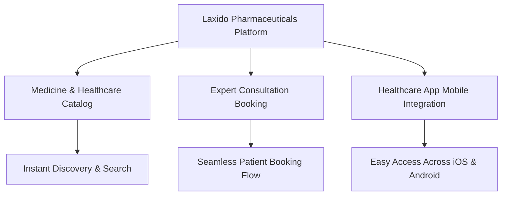

# Laxido Pharmaceuticals
### Healthcare & Medicine Solutions

**Laxido Pharmaceuticals** is a premier static web application delivering high-quality healthcare, medicine, and pharmaceutical solutions. Engineered for high performance, smooth responsiveness, and an engaging visual experience.

[Key Features](#-key-features) • [Tech Stack](#%EF%B8%8F-technology-stack) • [Deployment](#-deployment) • [Contact](#-contact)

---

## ✨ Digital Health & Care Workflow

Laxido Pharmaceuticals bridges healthcare services with modern web aesthetics to deliver fast, reliable digital experiences.

---

## 🚀 Key Features

*   **Custom Brand Identity**: Features transparent, custom Laxido Pharmaceuticals branding across header navigation, mobile app section, and footer.
*   **Fully Responsive Layout**: Built with flexible CSS grids and media queries to adapt to desktop, tablet, and mobile displays.
*   **Interactive UI Components**: Includes interactive location dropdowns, dynamic doctor sliders, client review counters, and search modules.
*   **Optimized Performance**: Standalone static asset bundle with zero external runtime brand injection, ensuring instant load times.
*   **Localized Contact Details**: Built-in direct email (`gkverma92@gmail.com`) and phone (`8863865036`) communication channels.

---

## 🛠️ Technology Stack

| Layer | Technology | Description |
| :--- | :--- | :--- |
| **Frontend Core** | HTML5 / JavaScript | Semantic structure and interactive UI state management |
| **Styling & Theme** | Custom Vanilla CSS | Tailored layout tokens, responsive grids, and typography |
| **Slider Engine** | Swiper.js | Interactive touch-friendly testimonial and hero sliders |
| **Icons & Media** | SVG & Transparent PNG | Optimized lightweight vector graphics and crisp brand assets |
| **Hosting** | GitHub Pages | Fast static deployment with global CDN distribution |

---

## 🌐 Deployment

This site is fully configured for deployment on **GitHub Pages**.

### Deploy via GitHub Pages:
1. Go to repository **Settings** -> **Pages**.
2. Under **Build and deployment** -> **Source**, select **Deploy from a branch**.
3. Choose branch **`main`** and folder **`/ (root)`**.
4. Click **Save**.

Live URL: `https://mohitraj8503.github.io/Laxido-Pharma/`

---

## 📞 Contact

*   **Email**: [gkverma92@gmail.com](mailto:gkverma92@gmail.com)
*   **Phone**: [8863865036](tel:8863865036)
*   **Copyright**: ©2026 Laxido Pharmaceuticals. All Rights Reserved.
